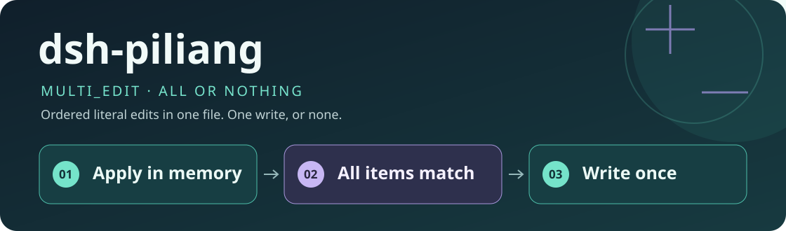
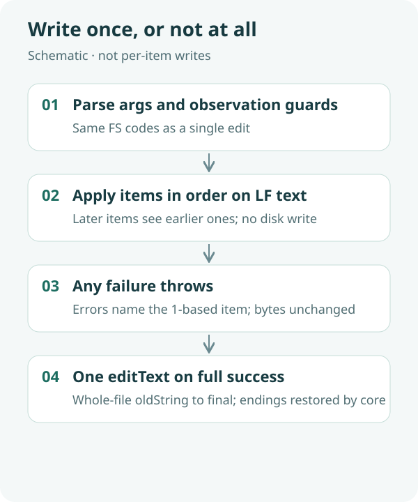

<div align="center">
  
  <h1>dsh-piliang</h1>
  <p><strong>Several literal edits in one file, one call; if any item fails, nothing is written.</strong></p>
  <p>A filesystem Host plugin for DeepSeek Harness Desktop that registers <code>multi_edit</code>.</p>
  <p><a href="README.md">简体中文</a> · <strong>English</strong></p>
  <p><a href="package.json">plugin 0.1.0</a> · Host-only ESM · no Client, no UI</p>
  <p><a href="#features">Features</a> · <a href="#how-it-works">How it works</a> · <a href="#quick-start">Quick start</a> · <a href="#configuration">Configuration</a> · <a href="#validation">Validation</a> · <a href="#faq">FAQ</a></p>
</div>

---

Stock `edit` replaces one span per call. Several spans mean several calls, and a later failure can leave earlier writes on disk. `dsh-piliang` adds **`multi_edit`**: ordered literal replacements on an already-read file, then a single official `editText` only if every item succeeds. If any item fails, the file bytes match the pre-call file.

It does not wrap or replace `edit` / `write`, and it does not patch DSH core. Later items see earlier replacements. Errors include a 1-based item number. Unread, stale, and sandbox codes match a single `edit`.

## Features

| Feature | Behavior |
|---|---|
| Ordered single-file edits | `file_path` plus a non-empty `edits[]` (`old_string` / `new_string` / optional `replace_all`) |
| All or nothing | The item loop runs on in-memory LF text; failure never calls `editText` |
| One publish | On success, one `editText(full text → final)`; line endings restored by core |
| Same codes as edit | Unread, stale, and sandbox denials match `edit` |
| Removable | Delete only this insert from the desktop patch; after ⌘Q, `multi_edit` is gone and `edit` remains |

## How it works



1. **Load**: the Desktop user patch inserts this plugin after built-in bundles and registers `multi_edit`.
2. **Guard**: parse args, sandbox policy, and `fs/edit-intent`, same family as `edit`.
3. **Apply in memory**: LF-normalized `split`/`join` in order; later items match post-earlier text.
4. **Publish or abort**: only then one `editText`; any failure throws with an item number and leaves bytes unchanged.
5. **Uninstall**: delete this insert only; fully quit and reopen.

This is not a cross-call database transaction. After a failure the model fixes the named item and retries the whole batch, or falls back to repeated `edit`.

## Quick start

### 1. Prerequisites

- DeepSeek Harness Desktop installed and runnable.
- Verified on macOS Desktop `0.2.1-alpha.4.20261020.1`. That is one installed build, not a compatibility claim for every similarly named version.
- Git to clone; runtime needs no extra npm tree. Windows, Linux, and other SDK builds are unverified.

### 2. Clone the plugin

The destination directory must not already exist; do not overwrite an install.

```sh
DSH_HOME="${DSH_HOME:-$HOME/.dsh}"
git clone https://github.com/yueyexiayu/dsh-piliang.git "$DSH_HOME/plugins/dsh-piliang"
```

### 3. Load it from the Desktop patch

**Merge** the following into the existing `$DSH_HOME/profiles/desktop/cordis.patch.yml`. Do not wipe other plugin rows. The path is relative to that profile patch file.

```yaml
- insert:
    - id: dsh-piliang
      name: ../../plugins/dsh-piliang/lib/index.js
```

The in-repo [bundle patch](cordis.patch.yml) uses package-relative paths and is not the profile-relative form. Do not change official DSH source.

### 4. Start and check

Fully quit Desktop (macOS: ⌘Q) and reopen. A new session should list both `multi_edit` and `edit`. After `read`, one `multi_edit` can change several spans in that file.

## Configuration

No config file and no custom HTTP routes. Injects `loader`, `tools`, `fs`, and `workingDirectory`. It does not set `isConcurrencySafe`, so scheduling stays exclusive like `edit`.

<details>
<summary><strong>Advanced: failure semantics and coexistence</strong></summary>

On item failure the file is unchanged and the error names `item N`. Fix that `old_string` or set `replace_all`, then resubmit the batch. Independent spans can use `edit` instead.

It can load beside `dsh-gongjuyasuo` and `dsh-bingxing`. Short success text does not need spilling. The stock `edit` tool is unchanged.

</details>

## Validation

On the verified Desktop `0.2.1-alpha.4.20261020.1`:

- `ELECTRON_RUN_AS_NODE=1` `test/*.test.mjs`: 15 passing tests (CRLF bytes match sequential `edit`, later items see earlier ones, `replace_all`, item failure leaves the file, ambiguous match, unread/stale/sandbox same codes as `edit`, empty file, coexistence with gongjuyasuo/bingxing).
- After Desktop ⌘Q, the catalog includes `multi_edit` and still includes `edit`. After removing the insert, `multi_edit` disappears and `edit` remains.

Not verified on Windows/Linux or other Desktop versions. No GitHub Actions; do not treat the local results as live CI.

```sh
cd "$DSH_HOME/plugins/dsh-piliang"
/usr/local/bin/node --check lib/index.js
ELECTRON_RUN_AS_NODE=1 "/Applications/DeepSeek Harness.app/Contents/MacOS/DeepSeek Harness" --test test/*.test.mjs
```

## FAQ

**What happens to the task if a call fails?**

The file is unchanged. Fix the named item and retry the whole batch, or use `edit` for independent spans. There is no protocol that keeps successful items and retries only the failure.

**Why not write each successful item?**

Later `old_string` values assume earlier replacements. A partial file is neither the original nor the goal. Use stock `edit` when you want per-item commits.

**How do I uninstall?**

Comment or delete only the `id: dsh-piliang` insert in desktop `cordis.patch.yml`, then ⌘Q. Do not empty the whole patch.

## Community and license

The public repository topic is `dsh-plugin`. Official DSH does not scrape repos automatically; community indexes scan that topic and still need a human check for the full catalog. This repository does not ship a license file.

<div align="center"><sub>Write once, or not at all · <a href="README.md">阅读中文版 →</a></sub></div>
