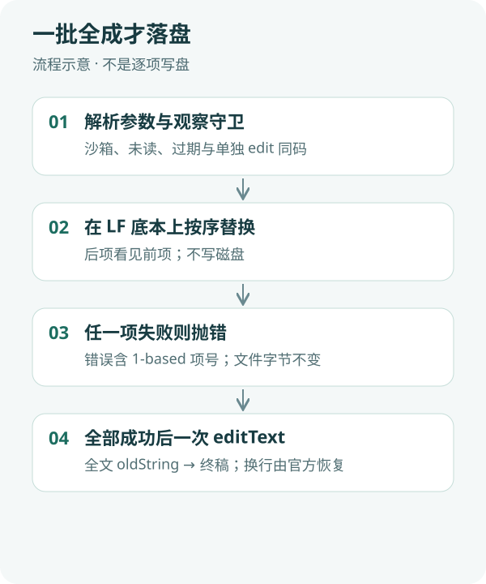

<div align="center">
  
  <h1>dsh-piliang</h1>
  <p><strong>同文件多处字面替换一次完成；任一项失败则整批不写盘。</strong></p>
  <p>面向 DeepSeek Harness Desktop 的纯 Host 文件系统插件，注册工具 <code>multi_edit</code>。</p>
  <p><strong>简体中文</strong> · <a href="README.en.md">English</a></p>
  <p><a href="package.json">插件 0.1.1</a> · 纯 Host / ESM · 无 Client、无 UI</p>
  <p><a href="#核心能力">核心能力</a> · <a href="#工作方式">工作方式</a> · <a href="#快速开始">快速开始</a> · <a href="#配置">配置</a> · <a href="#验证">验证</a> · <a href="#常见问题">常见问题</a></p>
</div>

---

官方 `edit` 每次只替换一处。同文件改多处就要多次调用，失败时前几处可能已经写盘。`dsh-piliang` 增加 **`multi_edit`**：在已读文件上按序做多处字面替换，全部成功后只调用一次官方 `editText`；任一项失败则文件与调用前完全一致。

不包装、不替换现有 `edit` / `write`，不改 DSH 核心。后项看见前项的结果。错误带 1-based 项号，权限/未读/过期码与单独 `edit` 相同。

## 核心能力

| 能力 | 具体行为 |
|---|---|
| 单文件有序替换 | `file_path` + 非空 `edits[]`（`old_string` / `new_string` / 可选 `replace_all`） |
| 全成或全不成 | 项循环只在内存 LF 文本上进行；失败不调用 `editText` |
| 一次发布 | 成功后一次 `editText(全文 → 终稿)`，换行恢复交给官方实现 |
| 与 edit 同码 | 未读、过期、沙箱拒绝的可见提示与 `edit` 一致 |
| 可卸载 | 去掉 desktop patch 中本插件那一条 insert，⌘Q 后 `multi_edit` 消失，`edit` 不变 |

## 工作方式



1. **加载**：Desktop 用户 patch 在内置 bundle 之后插入本插件，注册 `multi_edit`。
2. **守卫**：解析参数、沙箱策略、`fs/edit-intent` 观察要求，与 `edit` 同一套。
3. **内存应用**：在 LF 规范化底本上按序 `split`/`join`；后项匹配前项改完后的文本。
4. **发布或作废**：全部成功才一次 `editText`；任一项失败抛错（含项号），磁盘字节不变。
5. **卸载**：只删除本插件 insert，完全退出后重开。

这不是跨多次调用的数据库事务。失败后由模型根据项号改参数，再提交整批或改用多次 `edit`。

## 快速开始

### 1. 前置条件

- 已安装并可运行 DeepSeek Harness Desktop。
- 已验证环境：macOS、Desktop `0.2.1-alpha.4.20261020.1`。这是具体本机安装构建，不是所有同名/其他版本的兼容承诺。
- Git 用于下载；运行源码不需要新的 npm 依赖。Windows、Linux 及其他 SDK 构建尚未验证。

### 2. 下载插件

目标目录应尚不存在；已有安装不要覆盖。

```sh
DSH_HOME="${DSH_HOME:-$HOME/.dsh}"
git clone https://github.com/yueyexiayu/dsh-piliang.git "$DSH_HOME/plugins/dsh-piliang"
```

### 3. 配置 Desktop 加载

将下面一项**合并**到现有 `$DSH_HOME/profiles/desktop/cordis.patch.yml`，不要覆盖其他插件配置。路径相对于这份 profile patch 文件。

```yaml
- insert:
    - id: dsh-piliang
      name: ../../plugins/dsh-piliang/lib/index.js
```

仓库内的 [bundle patch](cordis.patch.yml) 是包内相对路径，不能直接当作 profile 相对路径使用。无需改 DSH 官方源码。

### 4. 启动与确认

完整退出 Desktop（macOS：⌘Q）后重新打开。新会话工具表应同时有 `multi_edit` 和 `edit`。对已 `read` 的同一文件，可用一次 `multi_edit` 改多处。

## 配置

本插件没有配置文件，也没有自定义 HTTP 路由。注入 `loader`、`tools`、`fs`、`workingDirectory`。不声明 `isConcurrencySafe`，调度上仍是独占，与 `edit` 一样。

<details>
<summary><strong>进阶：失败语义与共存</strong></summary>

项失败时文件不变，错误含 `item N`。模型应修正该 `old_string` 或改用 `replace_all`，再提交整批；独立替换也可退回多次 `edit`。

与 `dsh-gongjuyasuo`、`dsh-bingxing` 可同时挂载。短成功确认句不必外置。`edit` 工具保持原样。

</details>

## 验证

在已验证的 Desktop `0.2.1-alpha.4.20261020.1` 上：

- `ELECTRON_RUN_AS_NODE=1` 跑 `test/*.test.mjs`：16 项通过（CRLF 字节与逐次 `edit` 相同、后项依赖前项、`replace_all`、项失败不写盘、不唯一、未读/过期/沙箱与 `edit` 同码、空文件、预览读失败且多项时不把 `edits[0]` 单独写盘、与 gongjuyasuo/bingxing 共存）。
- Desktop ⌘Q 后工具表出现 `multi_edit` 且 `edit` 仍在。去掉 insert 后目录中 `multi_edit` 消失、`edit` 仍在。

未在 Windows/Linux 或其他 Desktop 版本上验证。没有 GitHub Actions；不要把上述本机结果当成实时 CI。

```sh
cd "$DSH_HOME/plugins/dsh-piliang"
/usr/local/bin/node --check lib/index.js
ELECTRON_RUN_AS_NODE=1 "/Applications/DeepSeek Harness.app/Contents/MacOS/DeepSeek Harness" --test test/*.test.mjs
```

## 常见问题

**失败了任务怎么继续？**

文件未改。根据项号修正 `edits` 后整批重试，或对独立替换改用 `edit`。没有「只重试失败项、已成功项保留」的协议。

**为什么不逐项写盘？**

后项按前项改完后的文本匹配。半成品既不是原文也不是目标。需要逐项落盘时用官方 `edit`。

**如何卸载？**

只注释或删除 desktop `cordis.patch.yml` 里 `id: dsh-piliang` 那一条 insert，然后 ⌘Q。不要清空整个 patch。

## 社区与许可

公开仓库 Topic 为 `dsh-plugin`。官方 DSH 不会自动抓仓库；社区目录按该 Topic 扫描，进全量目录还需对方核实。本仓库未附带许可证文件。

<div align="center"><sub>一批全成才落盘 · <a href="README.en.md">Read in English →</a></sub></div>
